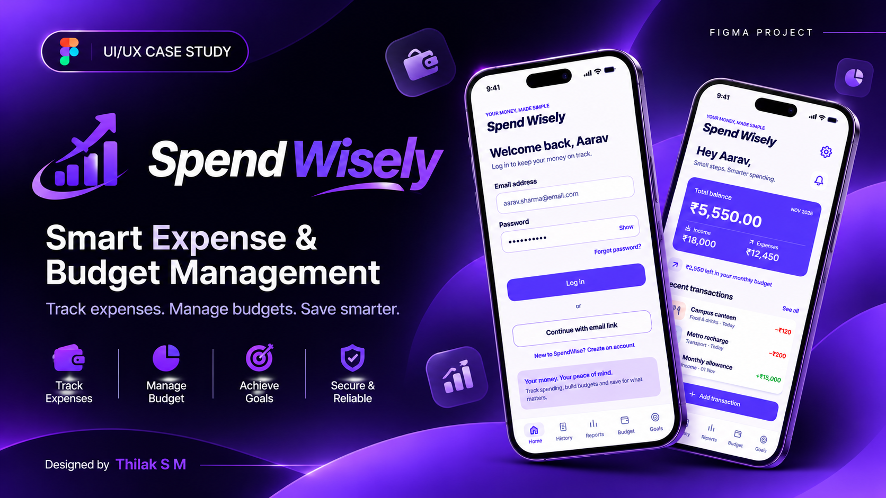

#  Spend Wisely

### Smart Expense & Budget Management App

A modern mobile application designed to make personal finance simple, organized and smarter.

**UI/UX CASE STUDY | FIGMA | MOBILE APPLICATION**

---

## 📌 About SpendWise

SpendWise is a smart expense tracking and budget management mobile application designed to help users manage their personal finances.

The application focuses on simplifying daily expense tracking, managing monthly budgets, monitoring financial activities and achieving savings goals through a clean and user-friendly interface.

## 🎯 Project Objectives

- Make expense tracking simple.
- Help users manage monthly budgets.
- Improve financial awareness.
- Encourage better saving habits.
- Provide an intuitive mobile experience.

## ✨ Key Features

| Feature | Description |
|---|---|
| Authentication | Login and account creation |
| Dashboard | Balance, income and expenses |
| Transactions | Daily expense tracking |
| Budget Management | Monthly budget planning |
| Savings Goals | Track financial goals |
| Reports | Financial insights and analytics |
| Profile | Personal account settings |

---

  

<h2 align="center">📱 Spend Wisely – UI Design Showcase</h2>

<h3>01. Authentication & Onboarding</h3>

  
  
  
  

<h3>02. Dashboard & Transactions</h3>

  
  
  
  

<h3>03. Expense & Income Management</h3>

  
  
  

<h3>04. Budget Management</h3>

  
  
  
  

<h3>05. Savings Goals</h3>

  
  
  

<h3>06. Reports & Analytics</h3>

  
  

<h3>07. Profile & Settings</h3>

  

---

## 🎨 Design Approach

- **Color palette:** Purple and violet accents.
- **Interface:** Clean and minimal.
- **Typography:** Modern and readable.
- **Components:** Rounded cards, buttons and input fields.
- **Experience:** Simple and intuitive navigation.

## 🛠️ Tools Used

- Figma
- UI Design
- UX Design
- Wireframing
- Prototyping

## 🔗 Interactive Figma Prototype

https://www.figma.com/design/T53oIXBaWJtQH6EeqVTSrC/expense-tracker---Spend-wisely?node-id=0-1&t=Gpe5DDwpZRpz21iQ-1

---

## 👨‍💻 Designer

**Thilak S M**

B.TECH. Computer Science & Business Systems

Interested in UI/UX Design, Software Development and Data Analytics.

**Designed using Figma**

